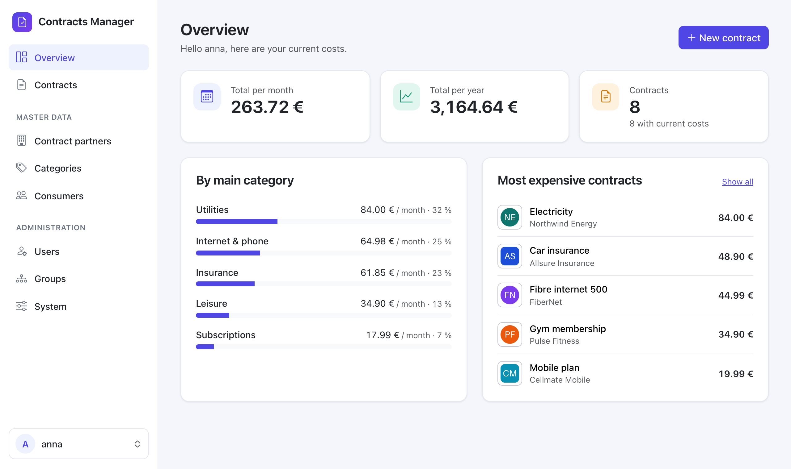
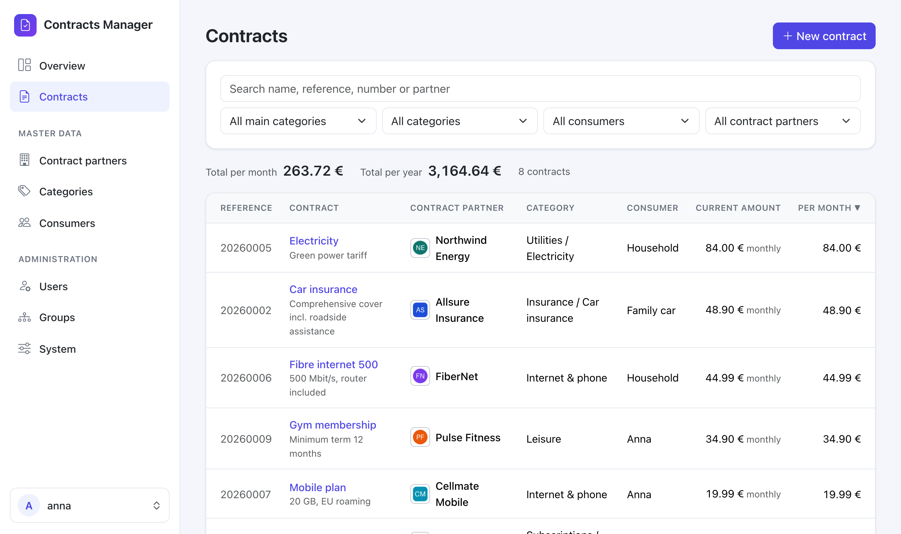
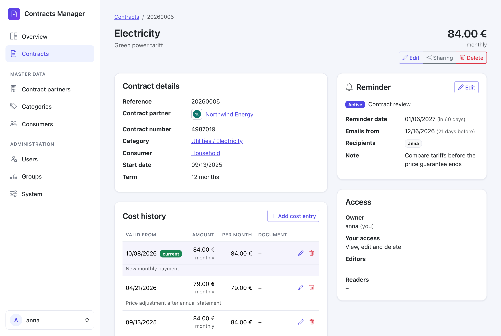
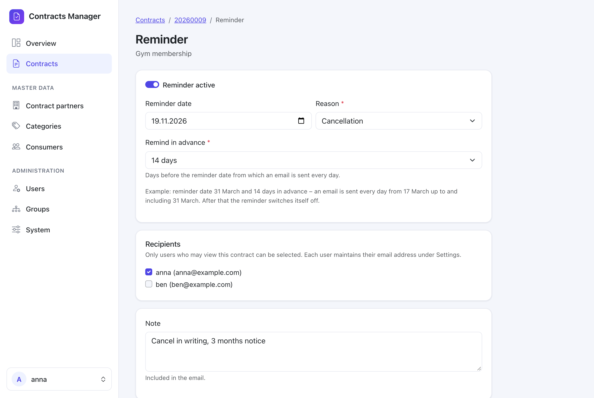
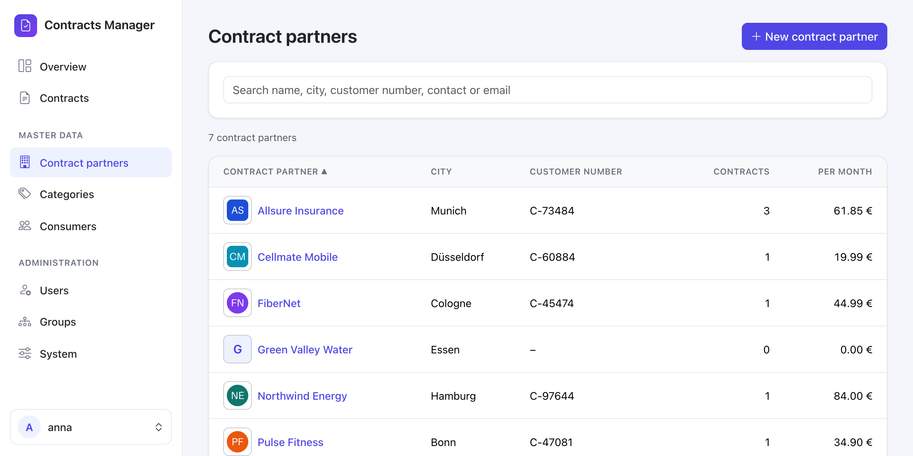
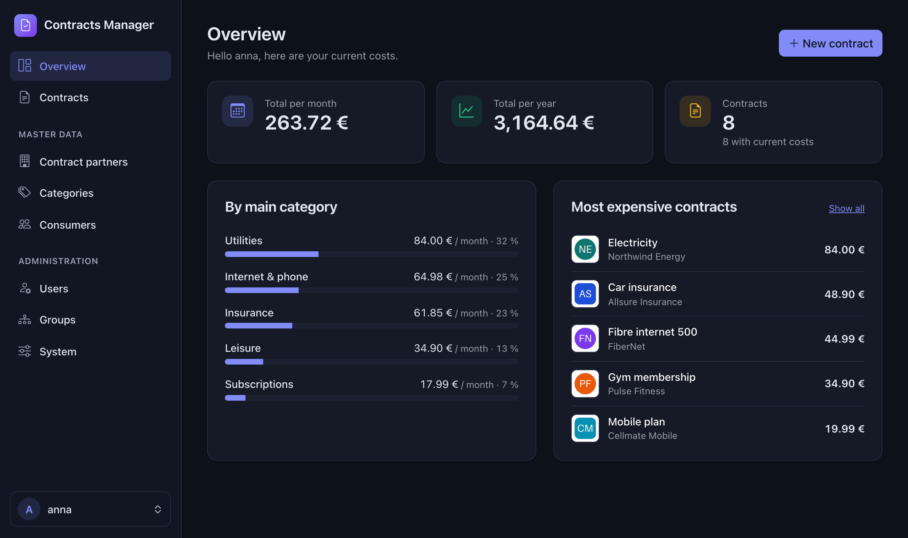
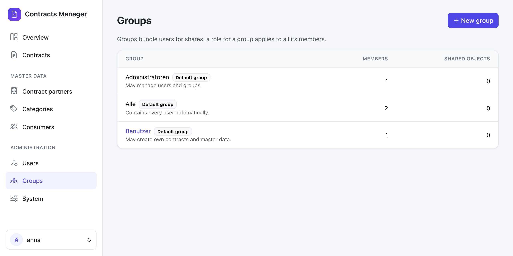
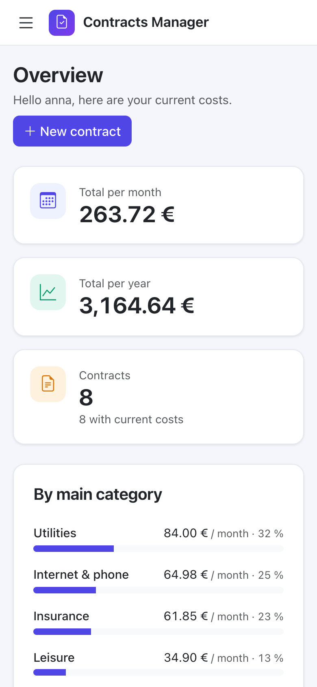

<div align="center">


# Contracts Manager

**Keep track of every contract, subscription and insurance policy in your household – self-hosted, private and shareable.**

[](#roadmap)
[](https://www.python.org/)
[](https://www.djangoproject.com/)
[](https://www.postgresql.org/)
[](docker-compose.yml)
[](LICENSE)

[Features](#features) · [Screenshots](#screenshots) · [Quick start](#quick-start) · [Docker image](#docker-image) · [Documentation](#documentation) · [Built with Claude](#built-with-claude)

</div>

<p align="center">
  
</p>

## What it does

Electricity, internet, mobile, insurance, streaming, the gym – most households have a dozen or more running contracts, each with its own price, payment interval, notice period and paperwork. **Contracts Manager** brings them together in one place:

- See at a glance **what you pay per month and per year**, and where the money goes.
- Record **price changes over time**, so you always know the current amount and the history behind it.
- Get an **email reminder** before a notice period ends or a contract should be reviewed.
- **Share** contracts with family members or housemates – read-only or with edit rights.
- Run it **on your own hardware** (built and tested for a Synology NAS with Docker), with your data on an encrypted volume.

The user interface is available in **English and German** (per user).

## Features

<table>
<tr>
<td width="50%" valign="top">

### 📄 Contracts and costs
- Contracts with partner, category, consumer, **payment method**, start date, term, contract number and notes with **Markdown** (headings, lists, links, tables)
- **Status as a traffic light**: active, notice sent, cancelled, archived – plus the date the cancellation takes effect; archived contracts leave the overview and the totals
- **Predecessor and successor**: link a contract to the one it replaces – both sides show the link
- Automatic reference numbers per year (e.g. `20260001`)
- Cost history with payment interval (weekly, monthly, quarterly, yearly); the current amount is picked by date
- **Documents** per contract: upload files (PDF, images, Office, up to 20 MB) or link Paperless-ngx documents, and attach them to cost entries
- Monthly and yearly totals, converted to a monthly basis
- Live search, filters with several values each (e.g. two consumers) and sorting; totals follow the filter

</td>
<td width="50%" valign="top">

### 🏢 Master data
- **Contract partners** with address, contact details, customer number and **logo upload** (resized, metadata removed)
- **Categories** as a two-level tree (e.g. *Insurance › Car insurance*)
- **Consumers** such as a person, a car or the household
- **Payment methods** with an icon; PayPal, American Express, Visa and direct debit (“Lastschrift”) come as editable defaults
- Everything is maintained in the web interface

</td>
</tr>
<tr>
<td valign="top">

### 🔐 Sharing and roles
- Every object has an **owner**; share with **readers** or **editors** – users or groups
- A built-in group **“Alle”** shares with everyone
- Invisible objects stay invisible (404), visible ones without rights are read-only (403)
- Ownership can be handed over; the previous owner keeps edit access

</td>
<td valign="top">

### 🔔 Reminders and email
- One reminder per contract: date, days in advance (0–60), reason (*cancellation*, *contract review*, *other*), recipients and a note
- Sent **daily** from the lead date up to the reminder date, then switched off automatically
- Background worker (django-q2) – no Redis needed
- Password reset and invitations by email (SMTP, e.g. IONOS)
- **System emails** to the group “Systemmail”: what's new after an update, and a notice when a new version is available

</td>
</tr>
<tr>
<td valign="top">

### 🛠️ Administration
- Manage **users and groups** in the web interface: invite by email, deactivate, delete, edit memberships
- Role **“Administratoren”** for user management without being a superuser – with safeguards against privilege escalation
- Superusers: transfer all objects of a user, see all reminders, link to the Django admin
- **Email, single sign-on, the AI assistant and Paperless** are configured in the app (superusers), each with a test – no restart, no `.env`
- System page with worker status, email settings and a test email

</td>
<td valign="top">

### 🔗 Integrations, AI and design
- **AI assistant** (optional): ask questions about your contracts, or upload a contract or invoice and let it propose the new contract – changes only after your approval; Claude, **Mistral AI**, OpenAI, an OpenAI-compatible provider or **Ollama** with local models, configured in the app (with a connection test and an editable system prompt); scans and photos are read by local text recognition (Tesseract) or an optional **document AI** – an OCR or vision model, e.g. **Mistral OCR**, a model at IONOS or in Ollama
- **Backup and import** of all data and files as a single ZIP file (without passwords), in the app or on the command line; backups of older versions (0.1.0 and later) can be imported
- **Single sign-on** with the Synology SSO Server (OpenID Connect), local login stays available
- **Paperless-ngx** via its API: Paperless documents open inside Contracts Manager (for everyone who may read the contract), uploads can be transferred to Paperless with tags and correspondent – or simple links only
- Clean, responsive interface with a sidebar, **light and dark mode** following the system setting
- All assets served locally – no CDN, no tracking
- Login lockout after repeated failed attempts, containers run as non-root

</td>
</tr>
</table>

## Screenshots

<table>
<tr>
<td width="50%"><p align="center"><sub>Contracts with live search, filters and totals</sub></p></td>
<td width="50%"><p align="center"><sub>Contract page with cost history and reminder</sub></p></td>
</tr>
<tr>
<td><p align="center"><sub>Email reminder before a notice period ends</sub></p></td>
<td><p align="center"><sub>Contract partners with logos</sub></p></td>
</tr>
<tr>
<td><p align="center"><sub>Dark mode</sub></p></td>
<td><p align="center"><sub>Administration of users and groups</sub></p></td>
</tr>
</table>

<p align="center">
  <br>
  <sub>Works on the phone, too</sub>
</p>

<sub>All screenshots show made-up demo data.</sub>

## Tech stack

| Area | Technology |
|---|---|
| Backend | Python 3.12, Django 5.2 LTS, django-guardian (per-object permissions) |
| Frontend | Django templates, HTMX 2, Bootstrap 5.3, Bootstrap Icons – no Node build |
| Database | PostgreSQL 17 (`pgvector/pgvector:pg17` image, ready for later RAG features) |
| Background jobs | django-q2 with the database as broker |
| AI (optional) | OpenAI and Anthropic Python SDKs; OpenAI-compatible providers and Ollama via base URL |
| Auth | Django auth, optional OpenID Connect (mozilla-django-oidc), login lockout (django-axes) |
| Images, Markdown | Pillow, markdown-it-py |
| Serving | gunicorn, whitenoise |
| Deployment | Docker Compose with three services: `app`, `worker`, `db` |

## Quick start

You need Docker with Docker Compose – on a Synology NAS the **Container Manager**. One file is enough; no `.env`, nothing to clone or build.

### On a Synology NAS (Container Manager)

1. In **File Station**, create the folder `docker/contracts-manager` and inside it the two folders `db` and `media`.
2. Download [`docker-compose.yml`](https://raw.githubusercontent.com/BrainX9/contracts-manager/main/docker-compose.yml) and replace `CHANGE_ME` with a password of your own (letters and digits).
3. In **Container Manager › Project › Create**: name `contracts-manager`, path the folder from step 1, source *Upload docker-compose.yml* (or *Create docker-compose.yml* and paste the file). Click **Next** until **Done**.
4. Open `http://<address-of-your-NAS>:8010` and create the first administrator.

### With the command line

```bash
mkdir contracts-manager && cd contracts-manager
curl -fsSLO https://raw.githubusercontent.com/BrainX9/contracts-manager/main/docker-compose.yml
mkdir db media
nano docker-compose.yml   # replace CHANGE_ME with a password of your own
docker compose up -d
```

Open <http://localhost:8010/>.

### What you get

On the first visit a new installation shows **Create administrator**: choose user name, email address (optional) and password. That account gets all rights, and the page disappears for good ([details](docs/configuration.md#first-administrator)). Create the administrator before the app is reachable from the internet.

```
contracts-manager/
├── docker-compose.yml
├── db/        PostgreSQL data   →  /var/lib/postgresql/data
├── media/     uploads           →  /app/media
└── config/    generated key     →  /config   (created automatically)
```

Three containers run: `contracts-manager-db`, `contracts-manager-app` and `contracts-manager-worker`. Migrations and translations are applied automatically on every start, and the folders `media` and `config` are given to the app user (`1000:1000`) – no `chown` needed.

**Next steps**

- Email, single sign-on, the AI assistant and Paperless are set up in the app under **Administration**.
- HTTPS with the reverse proxy of the NAS and daily backups: [installation guide](docs/installation-synology.md). Other reverse proxies (Nginx, Caddy, Traefik, Nginx Proxy Manager): [configuration › reverse proxy](docs/configuration.md#reverse-proxy).
- More settings (for example `ALLOWED_HOSTS`): [Configuration](#configuration) below and [all variables](docs/variables.md).
- Installations from before 0.9.0 keep their `docker-compose.yml` and `.env`; the file with `.env` is now called [`docker-compose.env.yml`](docker-compose.env.yml).

## Docker image

`app` and `worker` run a ready-made image from [Docker Hub](https://hub.docker.com/r/brainx9/contracts-manager). `docker compose up -d` downloads it; nothing is built on the server.

| | |
|---|---|
| Image | `brainx9/contracts-manager` on Docker Hub |
| Mirror | `ghcr.io/brainx9/contracts-manager` (GitHub Container Registry, same image and tags) |
| Tags | `latest` (newest release) and one per version, e.g. `0.9.0` |
| Platforms | `linux/amd64` and `linux/arm64` |
| Built by | GitHub Actions on every version tag (`v…`), after the tests passed |

- **Fixed version:** write e.g. `brainx9/contracts-manager:0.9.0` instead of `:latest` under `image:` (with `.env`: `APP_IMAGE_TAG=0.9.0`).
- **Update:** `docker compose pull`, `docker compose up -d` (see [Operations](docs/operations.md#update)).
- **Build it yourself** (for example for another platform): `docker build -t brainx9/contracts-manager:latest .` in the repository folder, then `docker compose up -d`. Compose uses the local image as long as it exists. For development use `docker-compose.dev.yml`, which builds locally and mounts the code ([Development](docs/development.md)).

## Configuration

Contracts Manager needs only a few settings before it starts. They are in the block `x-app-settings` at the top of `docker-compose.yml`; optional ones are commented out – remove the `#` to use them. Everything else – email, single sign-on, the AI assistant, Paperless – is set in the app under **Administration** (superusers), without a restart. Superusers also see the installed version there and a hint when a newer version exists (checked once a day at GitHub; can be switched off). After an update, every user sees a short **What's new** window once.

| | Variable | Default | Purpose |
|---|---|---|---|
| **Required** | `POSTGRES_DB`, `POSTGRES_USER` | `contracts_db`, `contracts_user` | Name of the database and its user |
| **Required** | `POSTGRES_PASSWORD` | – | Password of the database user (letters and digits) |
| Optional, *recommended* | `ALLOWED_HOSTS` | every address | Host names the app is reached at, comma separated |
| Optional | `CSRF_TRUSTED_ORIGINS` | – | Only if a reverse proxy changes the address or the scheme ([reverse proxy](docs/configuration.md#reverse-proxy)) |
| Optional | `USE_HTTPS` | `False` | `True` behind a reverse proxy with HTTPS |
| Optional | `APP_UID`, `APP_GID` | `1000` | User and group the app runs as; `media` and `config` are given to them automatically |
| Optional | `SECRET_KEY` | generated | Without it the app creates a key in the folder `config` |

**Advanced** variables (port, image version, AI fine tuning, login lockout, logging …) and the **archived** ones that the app reads no longer since 0.9.0: [all variables](docs/variables.md).

## Documentation

| Guide | Content |
|---|---|
| [Installation on a Synology NAS](docs/installation-synology.md) | Project folder, Compose file, Container Manager, first administrator, reverse proxy with HTTPS, daily backup |
| [Schritt-für-Schritt-Anleitung Synology (deutsch)](docs/installation-synology-de.md) | Detailed German walkthrough for beginners: Container Manager without SSH, Compose file, HTTPS, daily backups, updates, troubleshooting |
| [Environment variables](docs/variables.md) | All variables in four groups – required, optional, advanced, archived – and where to set them (Compose file or `.env`) |
| [Configuration](docs/configuration.md) | Users and sharing, settings in the app, email and reminders, single sign-on, notes with Markdown, documents, Paperless-ngx, AI assistant (also Ollama, document AI for scans and photos), version and updates, reverse proxy (Nginx, Caddy, Traefik, Nginx Proxy Manager) |
| [Operations](docs/operations.md) | Updates, backup and restore, export and import of all data as one file, restart with an encrypted folder |
| [Development](docs/development.md) | Local development, translations, tests, project structure |

## Roadmap

Planned, not yet implemented:

- REST API with automatic OpenAPI docs (django-ninja)
- MCP server on top of the same models
- Email client (IMAP) for contract-related mail
- Search across contract documents (RAG with pgvector)
- AI features such as summaries and detecting notice periods

## Built with Claude

> [!IMPORTANT]
> This project was developed primarily by **[Claude](https://www.anthropic.com/claude)** (Anthropic's AI assistant, via [Claude Code](https://claude.com/claude-code)), working phase by phase under the direction and review of the maintainer. Requirements, decisions and testing are human; most of the code, tests and documentation were written by Claude.

Every version was planned first, then implemented in small, reviewed steps with automated tests (currently over 600) and checked in the browser. Commits made with Claude carry a `Co-Authored-By` trailer.

## License

[MIT](LICENSE) © 2026 BrainX9
