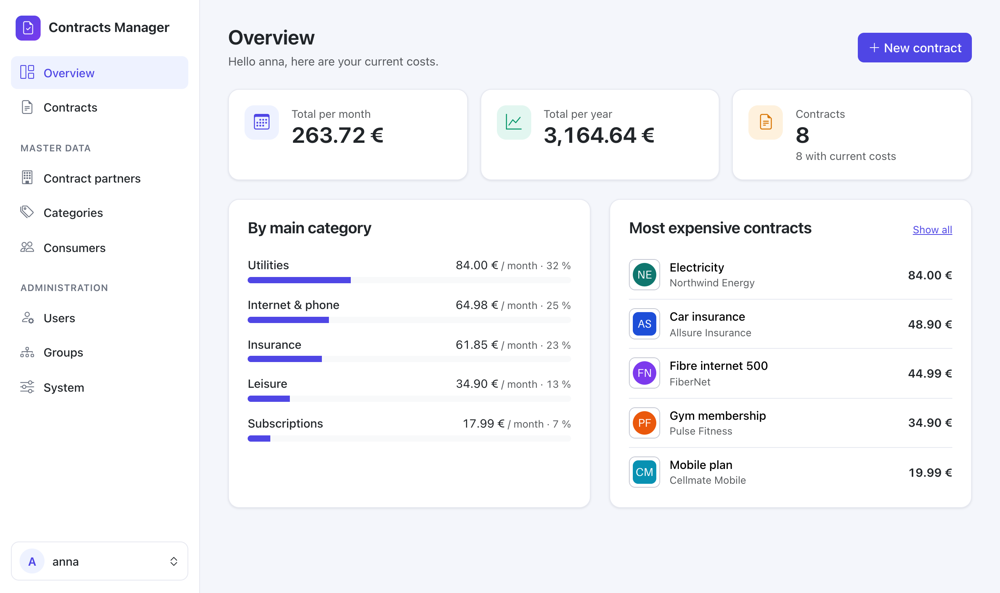
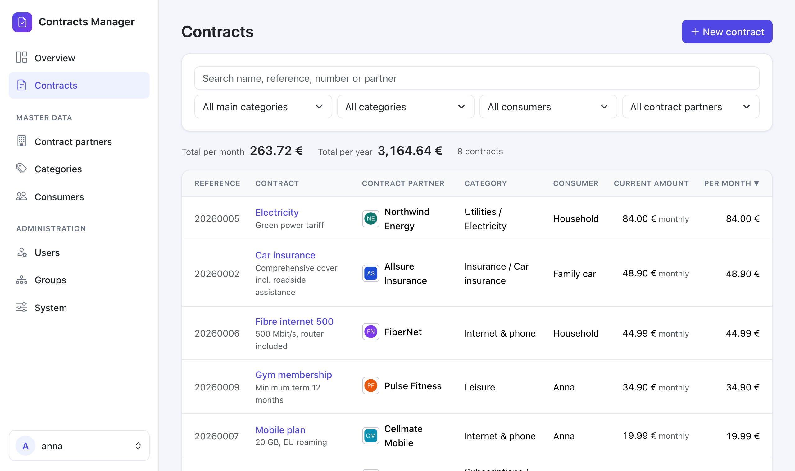
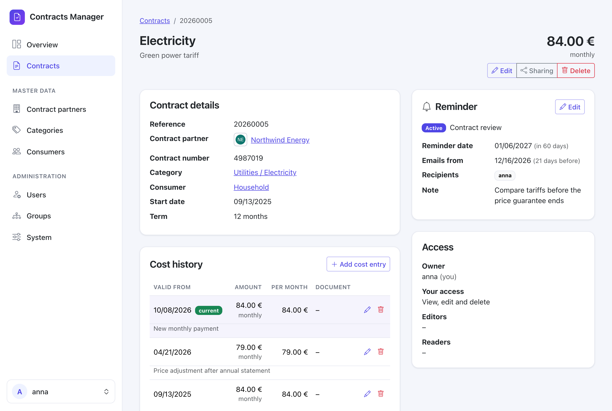
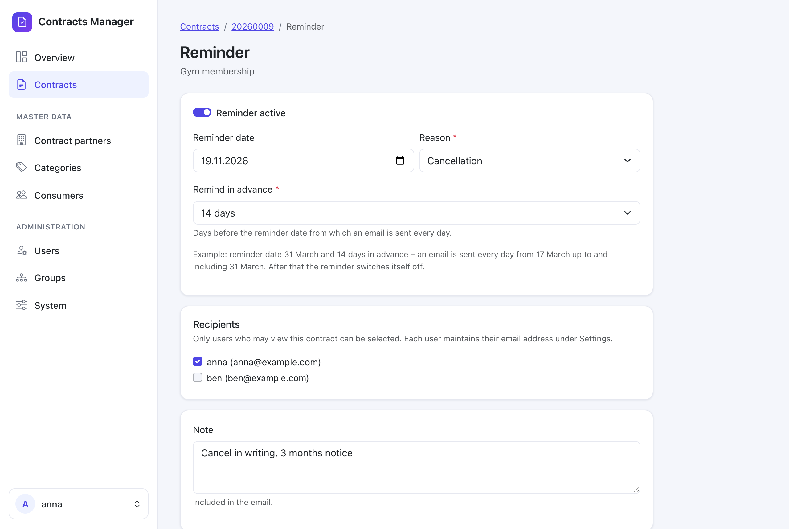
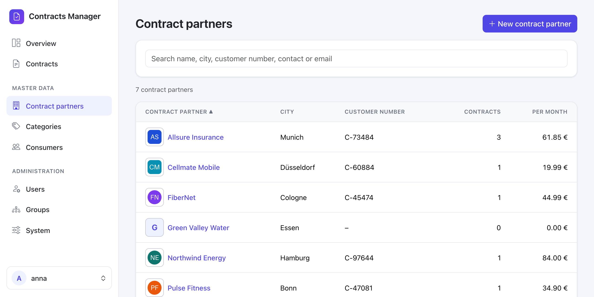
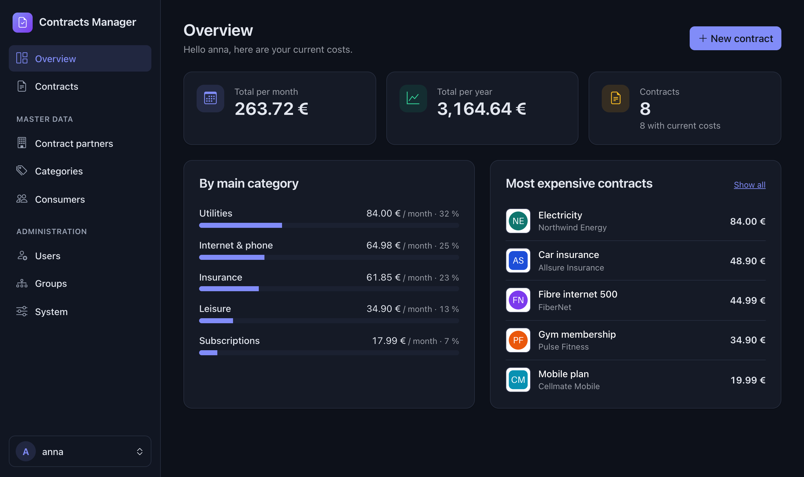
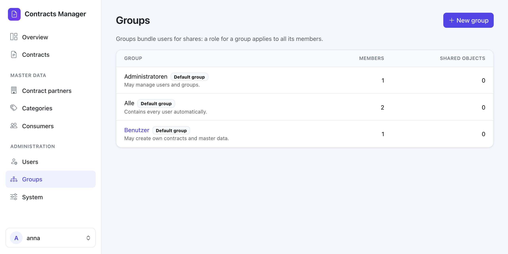
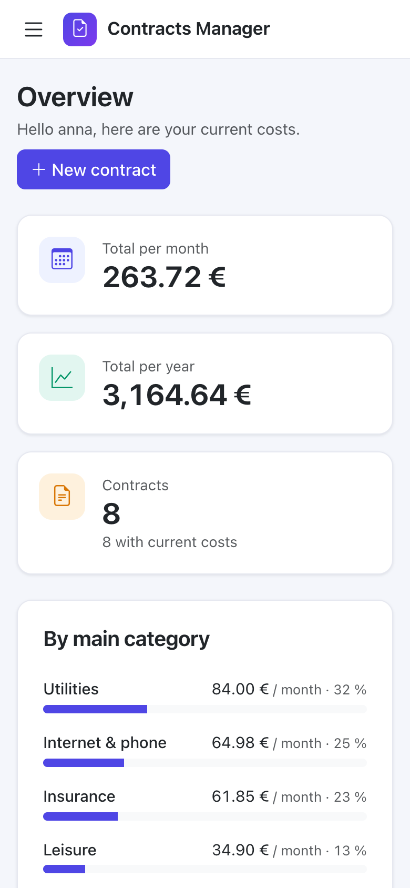

<div align="center">


# Contracts Manager

**Keep track of every contract, subscription and insurance policy in your household – self-hosted, private and shareable.**

[](#roadmap)
[](https://www.python.org/)
[](https://www.djangoproject.com/)
[](https://www.postgresql.org/)
[](docker-compose.yml)
[](LICENSE)

[Features](#features) · [Screenshots](#screenshots) · [Quick start](#quick-start) · [Docker image](#docker-image) · [Documentation](#documentation) · [Built with Claude](#built-with-claude)

</div>

<p align="center">
  
</p>

## What it does

Electricity, internet, mobile, insurance, streaming, the gym – most households have a dozen or more running contracts, each with its own price, payment interval, notice period and paperwork. **Contracts Manager** brings them together in one place:

- See at a glance **what you pay per month and per year**, and where the money goes.
- Record **price changes over time**, so you always know the current amount and the history behind it.
- Get an **email reminder** before a notice period ends or a contract should be reviewed.
- **Share** contracts with family members or housemates – read-only or with edit rights.
- Run it **on your own hardware** (built and tested for a Synology NAS with Docker), with your data on an encrypted volume.

The user interface is available in **English and German** (per user).

## Features

<table>
<tr>
<td width="50%" valign="top">

### 📄 Contracts and costs
- Contracts with partner, category, consumer, start date, term, contract number and notes
- Automatic reference numbers per year (e.g. `20260001`)
- Cost history with payment interval (weekly, monthly, quarterly, yearly); the current amount is picked by date
- **Documents** per contract: upload files (PDF, images, Office, up to 20 MB) or link Paperless-ngx documents, and attach them to cost entries
- Monthly and yearly totals, converted to a monthly basis
- Live search, filters and sorting; totals follow the filter

</td>
<td width="50%" valign="top">

### 🏢 Master data
- **Contract partners** with address, contact details, customer number and **logo upload** (resized, metadata removed)
- **Categories** as a two-level tree (e.g. *Insurance › Car insurance*)
- **Consumers** such as a person, a car or the household
- Everything is maintained in the web interface

</td>
</tr>
<tr>
<td valign="top">

### 🔐 Sharing and roles
- Every object has an **owner**; share with **readers** or **editors** – users or groups
- A built-in group **“Alle”** shares with everyone
- Invisible objects stay invisible (404), visible ones without rights are read-only (403)
- Ownership can be handed over; the previous owner keeps edit access

</td>
<td valign="top">

### 🔔 Reminders and email
- One reminder per contract: date, days in advance (0–60), reason (*cancellation*, *contract review*, *other*), recipients and a note
- Sent **daily** from the lead date up to the reminder date, then switched off automatically
- Background worker (django-q2) – no Redis needed
- Password reset and invitations by email (SMTP, e.g. IONOS)

</td>
</tr>
<tr>
<td valign="top">

### 🛠️ Administration
- Manage **users and groups** in the web interface: invite by email, deactivate, delete, edit memberships
- Role **“Administratoren”** for user management without being a superuser – with safeguards against privilege escalation
- Superusers: transfer all objects of a user, see all reminders, link to the Django admin
- System page with worker status, email settings and a test email

</td>
<td valign="top">

### 🔗 Integrations, AI and design
- **AI assistant** (optional): ask questions about your contracts, or upload a contract or invoice and let it propose the new contract – changes only after your approval; Claude, OpenAI or OpenAI-compatible providers; local text recognition (Tesseract)
- **Backup and import** of all data and files as a single ZIP file (without passwords), in the app or on the command line
- **Single sign-on** with the Synology SSO Server (OpenID Connect), local login stays available
- **Paperless-ngx** links to documents and correspondents (links only, no access to Paperless)
- Clean, responsive interface with a sidebar, **light and dark mode** following the system setting
- All assets served locally – no CDN, no tracking
- Login lockout after repeated failed attempts, containers run as non-root

</td>
</tr>
</table>

## Screenshots

<table>
<tr>
<td width="50%"><p align="center"><sub>Contracts with live search, filters and totals</sub></p></td>
<td width="50%"><p align="center"><sub>Contract page with cost history and reminder</sub></p></td>
</tr>
<tr>
<td><p align="center"><sub>Email reminder before a notice period ends</sub></p></td>
<td><p align="center"><sub>Contract partners with logos</sub></p></td>
</tr>
<tr>
<td><p align="center"><sub>Dark mode</sub></p></td>
<td><p align="center"><sub>Administration of users and groups</sub></p></td>
</tr>
</table>

<p align="center">
  <br>
  <sub>Works on the phone, too</sub>
</p>

<sub>All screenshots show made-up demo data.</sub>

## Tech stack

| Area | Technology |
|---|---|
| Backend | Python 3.12, Django 5.2 LTS, django-guardian (per-object permissions) |
| Frontend | Django templates, HTMX 2, Bootstrap 5.3, Bootstrap Icons – no Node build |
| Database | PostgreSQL 17 (`pgvector/pgvector:pg17` image, ready for later RAG features) |
| Background jobs | django-q2 with the database as broker |
| AI (optional) | OpenAI and Anthropic Python SDKs; OpenAI-compatible providers via base URL |
| Auth | Django auth, optional OpenID Connect (mozilla-django-oidc), login lockout (django-axes) |
| Images | Pillow |
| Serving | gunicorn, whitenoise |
| Deployment | Docker Compose with three services: `app`, `worker`, `db` |

## Quick start

You need Docker with Docker Compose. Everything runs from one folder with two files; nothing is cloned or built:

```bash
mkdir contracts-manager && cd contracts-manager
curl -fsSLO https://raw.githubusercontent.com/BrainX9/contracts-manager/main/docker-compose.yml
curl -fsSL https://raw.githubusercontent.com/BrainX9/contracts-manager/main/.env.example -o .env
```

Edit `.env`: set `SECRET_KEY` and `POSTGRES_PASSWORD`, your first administrator (`ADMIN_USERNAME`, `ADMIN_PASSWORD`, optionally `ADMIN_EMAIL`), and for a local test also

```dotenv
DEBUG=True
ALLOWED_HOSTS=localhost,127.0.0.1
CSRF_TRUSTED_ORIGINS=http://localhost:8000
USE_HTTPS=False
```

Create the data folders and start the stack. On the first start the administrator is created from `.env` ([details](docs/configuration.md#first-administrator)):

```bash
mkdir db media backups
# On Linux hosts only: the containers run as user 1000, not root
sudo chown -R 1000:1000 media
docker compose up -d
```

Prefer to create the account by hand? Leave the `ADMIN_*` variables out and run `docker compose exec app python manage.py createsuperuser`.

The folder then looks like this; database and uploads stay outside the containers:

```
contracts-manager/
├── docker-compose.yml
├── .env
├── db/        PostgreSQL data   →  /var/lib/postgresql/data
├── media/     uploads           →  /app/media
└── backups/
```

Three containers run: `contracts-manager-db`, `contracts-manager-app` and `contracts-manager-worker` (the Compose services are called `db`, `app` and `worker`). Docker downloads the ready-made image, see [Docker image](#docker-image) below.

Open <http://localhost:8000/> and log in with the administrator from `.env`; then change the password in the app and remove `ADMIN_PASSWORD` from `.env`. Migrations and translations are applied automatically on every start.

For a production setup on a Synology NAS (project folder, reverse proxy with HTTPS, daily backups) see the [installation guide](docs/installation-synology.md).

## Docker image

`app` and `worker` run a ready-made image from the GitHub Container Registry. `docker compose up -d` downloads it; nothing is built on the server.

| | |
|---|---|
| Image | `ghcr.io/brainx9/contracts-manager` |
| Tags | `latest` (newest release) and one per version, e.g. `0.1.0` |
| Platforms | `linux/amd64` and `linux/arm64` |
| Built by | GitHub Actions on every version tag (`v…`), after the tests passed |

- **Fixed version:** set `APP_IMAGE_TAG=0.1.0` in `.env` to stay on one version; the default is `latest`.
- **Update:** `docker compose pull`, `docker compose up -d` (see [Operations](docs/operations.md#update)).
- **Build it yourself** (for example for another platform): `docker build -t ghcr.io/brainx9/contracts-manager:latest .` in the repository folder, then `docker compose up -d`. Compose uses the local image as long as it exists. For development use `docker-compose.dev.yml`, which builds locally and mounts the code ([Development](docs/development.md)).

## Configuration

All settings come from environment variables in `.env` – no secrets in the code. The most important ones:

| Variable | Purpose |
|---|---|
| `SECRET_KEY`, `DEBUG` | Django basics |
| `ALLOWED_HOSTS`, `CSRF_TRUSTED_ORIGINS`, `USE_HTTPS` | Host names and HTTPS behind a reverse proxy |
| `POSTGRES_DB`, `POSTGRES_USER`, `POSTGRES_PASSWORD` | Database |
| `DATA_PATH`, `APP_PORT` | Where data lives on the host, published port |
| `APP_IMAGE_TAG` | Version of the Docker image (default `latest`, e.g. `0.1.0` to stay on one version) |
| `APP_UID`, `APP_GID` | User and group the containers run as (default `1000`, not root) |
| `EMAIL_HOST`, `EMAIL_PORT`, `EMAIL_USE_TLS`, `EMAIL_HOST_USER`, `EMAIL_HOST_PASSWORD`, `DEFAULT_FROM_EMAIL` | SMTP for reminders, invitations and password reset |
| `APP_BASE_URL` | Public address of the app, used for links in emails |
| `REMINDER_SEND_TIME` | Daily time for reminders (default `07:00`) |
| `OIDC_ENABLED`, `OIDC_OP_BASE_URL`, `OIDC_RP_CLIENT_ID`, `OIDC_RP_CLIENT_SECRET`, `OIDC_CREATE_USERS` | Single sign-on |
| `PAPERLESS_URL` | Base address of Paperless-ngx for links |
| `AI_ENABLED`, `AI_PROVIDER`, `AI_API_KEY`, `AI_MODEL`, `AI_BASE_URL` | Optional AI assistant |
| `AXES_FAILURE_LIMIT`, `AXES_COOLOFF_MINUTES`, `SECURE_HSTS_SECONDS` | Login lockout after failed attempts, optional HSTS |

[`.env.example`](.env.example) lists every variable with comments. Details: [configuration guide](docs/configuration.md).

## Documentation

| Guide | Content |
|---|---|
| [Installation on a Synology NAS](docs/installation-synology.md) | Project folder, Compose file and `.env`, first start, superuser, reverse proxy with HTTPS, daily backup |
| [Schritt-für-Schritt-Anleitung Synology (deutsch)](docs/installation-synology-de.md) | Detailed German walkthrough for beginners: Container Manager, SSH, Compose file and `.env`, HTTPS, daily backups, updates, troubleshooting |
| [Configuration](docs/configuration.md) | Users and sharing, email and reminders, single sign-on, documents, Paperless-ngx, AI assistant |
| [Operations](docs/operations.md) | Updates, backup and restore, export and import of all data as one file, restart with an encrypted folder |
| [Development](docs/development.md) | Local development, translations, tests, project structure |

## Roadmap

Planned, not yet implemented:

- REST API with automatic OpenAPI docs (django-ninja)
- MCP server on top of the same models
- Email client (IMAP) for contract-related mail
- Search across contract documents (RAG with pgvector)
- AI features such as summaries and detecting notice periods

## Built with Claude

> [!IMPORTANT]
> This project was developed primarily by **[Claude](https://www.anthropic.com/claude)** (Anthropic's AI assistant, via [Claude Code](https://claude.com/claude-code)), working phase by phase under the direction and review of the maintainer. Requirements, decisions and testing are human; most of the code, tests and documentation were written by Claude.

Every version was planned first, then implemented in small, reviewed steps with automated tests (currently around 360) and checked in the browser. Commits made with Claude carry a `Co-Authored-By` trailer.

## License

[MIT](LICENSE) © 2026 BrainX9
