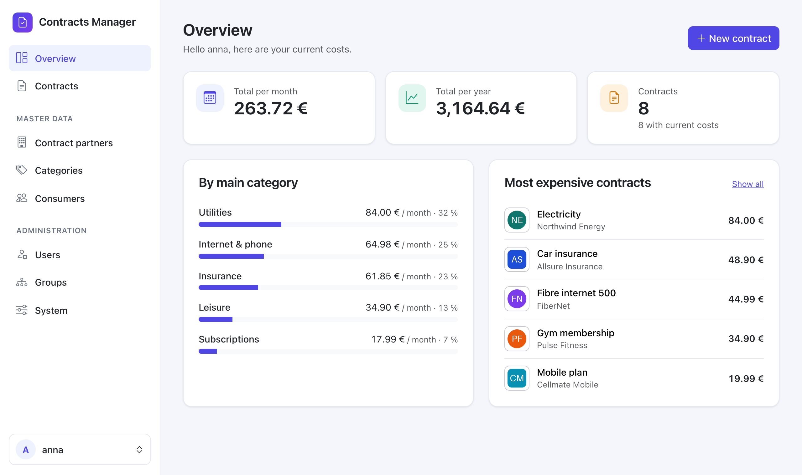

<!--
  Text for the "Repository overview" on Docker Hub (hub.docker.com/r/brainx9/contracts-manager).
  Docker Hub does not read this file automatically: copy everything below this comment
  into the overview there after a release. Links are absolute, because Docker Hub shows the text outside GitHub.
-->
# Contracts Manager

**Keep track of every contract, subscription and insurance policy in your household – self-hosted, private and shareable.**



Source code, documentation and issues: **[github.com/BrainX9/contracts-manager](https://github.com/BrainX9/contracts-manager)**

## What it does

Electricity, internet, mobile, insurance, streaming, the gym – most households have a dozen or more running contracts. Contracts Manager brings them together in one place:

- See **what you pay per month and per year**, and where the money goes.
- Record **price changes over time**; the current amount is picked by date.
- Keep track of every contract with a **status traffic light** – active, notice sent, cancelled, archived – and the date a cancellation takes effect. Archived contracts leave the overview and the totals.
- Link **predecessor and successor** contracts, e.g. when you change tariff or insurer.
- Get an **email reminder** before a notice period ends.
- Attach **documents** to contracts: upload files or use **Paperless-ngx** – via its API, Paperless documents open inside the app and uploads can be transferred to Paperless.
- **Share** contracts with family members – read-only or with edit rights.
- Optional **AI assistant** (Claude, **Mistral AI**, OpenAI, an OpenAI-compatible provider such as IONOS, or **Ollama** with local models): ask questions about your contracts or let it propose a new contract from an uploaded document. Changes only after your approval.
- **Scans and photos** are read by local text recognition (Tesseract) or an optional **document AI** – an OCR or vision model, e.g. **Mistral OCR**, a model at IONOS or in Ollama.
- **Notes with Markdown** on contracts, contract partners and consumers.
- **Email, single sign-on (OpenID Connect, e.g. Synology SSO Server), the AI assistant and Paperless are set up in the app**, with a test button and without a restart.
- **Easy start:** one Compose file, one password to set – no `.env`, no `chown`; the secret key is generated.
- **Backup and import** of all data and files as a single ZIP file.
- Superusers see the installed version and a **hint when an update is available**.
- After an update, every user sees **What's new** once; members of the group *Systemmail* also get it by email, superusers an email when a new version is available.
- Interface in **English and German**, light and dark mode, works on the phone.
- All assets served locally – no CDN, no tracking.

## Tags

| Tag | Meaning |
|---|---|
| `latest` | newest release |
| `0.9.0`, `0.8.0`, … | one tag per version |

Platforms: `linux/amd64` and `linux/arm64`. The image is built by GitHub Actions on every version tag, after the tests passed. The same image is also available as `ghcr.io/brainx9/contracts-manager`.

## Quick start

The image needs a PostgreSQL database and a background worker, so it is started with **Docker Compose**, not with a single `docker run`. One file is enough – no `.env`:

```bash
mkdir contracts-manager && cd contracts-manager
curl -fsSLO https://raw.githubusercontent.com/BrainX9/contracts-manager/main/docker-compose.yml
mkdir db media
```

Open `docker-compose.yml` and replace `CHANGE_ME` with a database password of your own (letters and digits). Then:

```bash
docker compose up -d
```

Open <http://localhost:8010/>. A new installation asks for the **first administrator** in the browser – create it right away, before the app is reachable from the internet.

On a **Synology NAS**: create the folders `db` and `media` in File Station, then *Container Manager › Project › Create* with this file ([guide](https://github.com/BrainX9/contracts-manager/blob/main/docs/installation-synology.md)).

Installations from before 0.9.0 keep their `docker-compose.yml` and `.env`; the Compose file with `.env` is now [`docker-compose.env.yml`](https://github.com/BrainX9/contracts-manager/blob/main/docker-compose.env.yml).

## What runs

| Container | Image | Purpose |
|---|---|---|
| `contracts-manager-app` | `brainx9/contracts-manager` | web application (gunicorn, port 8010 on the host) |
| `contracts-manager-worker` | `brainx9/contracts-manager` | background jobs: reminders, update check, AI assistant, Paperless |
| `contracts-manager-db` | `pgvector/pgvector:pg17` | PostgreSQL 17 |

Data stays outside the containers, next to the Compose file:

| Folder on the host | In the container | Content |
|---|---|---|
| `db/` | `/var/lib/postgresql/data` | database |
| `media/` | `/app/media` | uploads, logos, documents |
| `config/` | `/config` | generated secret key (created automatically) |

The container starts as root only to give `media` and `config` to the app user (`APP_UID:APP_GID`, default `1000:1000`), then runs everything as that user. Database migrations are applied automatically on every start.

## Configuration

Only a few settings are needed before the app runs; they are at the top of `docker-compose.yml` (optional ones commented out). Everything else – email, single sign-on, the AI assistant, Paperless – is set in the app under **Administration** (superusers), without a restart.

| | Variable | Default | Purpose |
|---|---|---|---|
| **Required** | `POSTGRES_DB`, `POSTGRES_USER` | `contracts_db`, `contracts_user` | database name and user |
| **Required** | `POSTGRES_PASSWORD` | – | database password |
| Optional | `ALLOWED_HOSTS` | every address | recommended: host names the app is reached at, comma separated |
| Optional | `CSRF_TRUSTED_ORIGINS` | – | only if the reverse proxy changes the address or the scheme |
| Optional | `USE_HTTPS` | `False` | `True` behind a reverse proxy with HTTPS |
| Optional | `APP_UID`, `APP_GID` | `1000` | user and group the app runs as |
| Optional | `SECRET_KEY` | generated | without it the app creates a key in `config/` |

Advanced variables (logging, login lockout, AI fine tuning …) and the archived ones that the app reads no longer since 0.9.0: [all variables](https://github.com/BrainX9/contracts-manager/blob/main/docs/variables.md).

## Update

Create a backup first, then:

```bash
docker compose pull
docker compose up -d
```

To stay on one version, use a fixed tag such as `brainx9/contracts-manager:0.9.0`. Superusers see a hint in the app when a new version is out. Release notes: [GitHub releases](https://github.com/BrainX9/contracts-manager/releases).

## Documentation

- [Installation on a Synology NAS](https://github.com/BrainX9/contracts-manager/blob/main/docs/installation-synology.md) (reverse proxy with HTTPS, daily backup)
- [Schritt-für-Schritt-Anleitung Synology (deutsch)](https://github.com/BrainX9/contracts-manager/blob/main/docs/installation-synology-de.md)
- [Configuration](https://github.com/BrainX9/contracts-manager/blob/main/docs/configuration.md)
- [Environment variables](https://github.com/BrainX9/contracts-manager/blob/main/docs/variables.md)
- [Operations](https://github.com/BrainX9/contracts-manager/blob/main/docs/operations.md) (updates, backup and restore)
- [Development](https://github.com/BrainX9/contracts-manager/blob/main/docs/development.md)

## Support

Questions and bug reports: [GitHub issues](https://github.com/BrainX9/contracts-manager/issues).

## License

[MIT](https://github.com/BrainX9/contracts-manager/blob/main/LICENSE) © 2026 BrainX9
